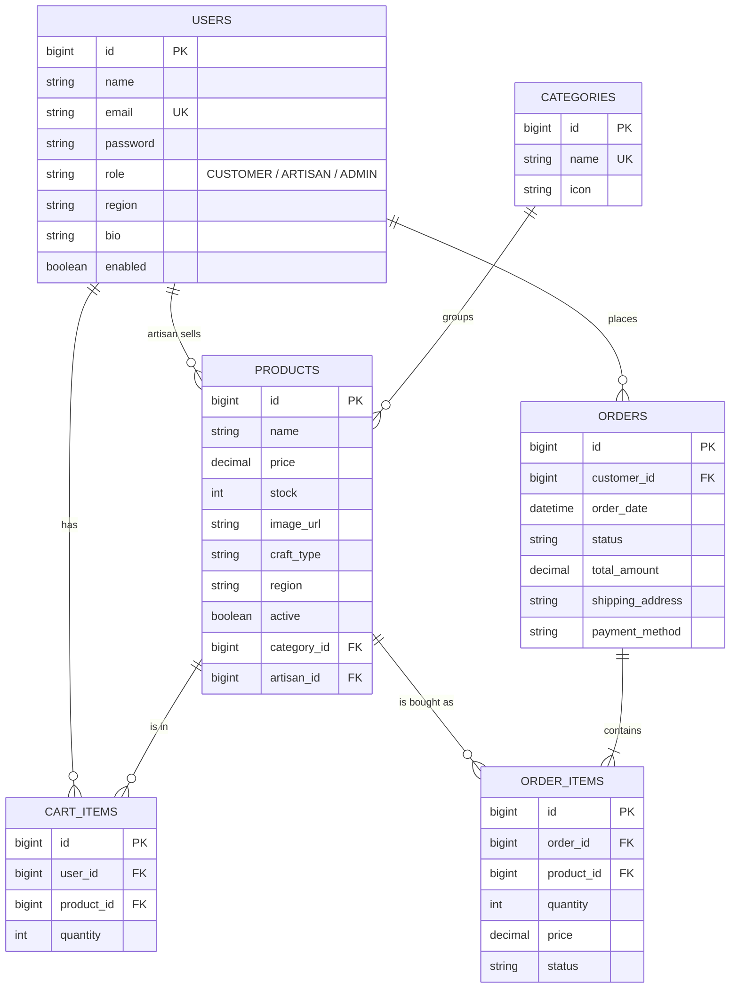

# Kaithari: Handloom & Artisan Direct-to-Consumer Marketplace

A full-stack e-commerce web application where handloom weavers and artisans list their products
and sell **directly** to customers. Built with **Java 17, Spring Boot 3, Spring Security, Spring Data JPA,
Thymeleaf and Bootstrap 5**. Works out of the box with an embedded H2 database, and can be switched to MySQL with one setting.

---

## 1. Run it in IntelliJ IDEA (5 minutes)

**Requirements:** JDK 17 or newer (JDK 21 works too), IntelliJ IDEA (Community or Ultimate), and an internet connection
for the first run (Maven downloads libraries; the page also loads Bootstrap from a CDN).

1. Extract the zip.
2. In IntelliJ: **File > Open** and select the extracted `handloom-marketplace` folder (the one containing `pom.xml`).
   Choose **Open as Project** and **Trust Project** if asked.
3. Wait for the bottom-right progress bar (Maven is importing dependencies). If it does not start,
   right-click `pom.xml` > **Maven > Reload project**.
4. Check the JDK: **File > Project Structure > Project > SDK** must be 17 or higher.
5. Open `src/main/java/com/handloom/marketplace/MarketplaceApplication.java` and click the green **Run** arrow.
6. Open **http://localhost:8080** in your browser.

On the first start the app creates all tables and loads demo data (6 artisans, 16 products, 6 categories).

### Demo logins

| Role     | Email                    | Password      |
|----------|--------------------------|---------------|
| Admin    | admin@handloom.com       | admin123      |
| Artisan  | lakshmi@handloom.com     | artisan123    |
| Artisan  | rashid@handloom.com      | artisan123    |
| Customer | customer@handloom.com    | customer123   |

(Other artisans: farhan, meera, suresh, ramesh @handloom.com, all with `artisan123`.)
You can also register new customer and artisan accounts from the **Create account** page.

---

## 2. Using MySQL instead of H2

1. Start MySQL. The database is created automatically if it does not exist.
2. Edit `src/main/resources/application-mysql.properties` and set your MySQL username and password.
3. In IntelliJ: **Run > Edit Configurations > MarketplaceApplication > Modify options > Add VM options**, then enter
   `-Dspring.profiles.active=mysql`
   (or put `spring.profiles.active=mysql` at the bottom of `application.properties`).
4. Run again. Tables are created automatically and demo data is loaded into `handloom_db`.

To reset the default H2 data, stop the app and delete the `data/` folder in the project root.

---

## 3. Features

**Customer**
- Register and log in, browse and search products, filter by category, sort by price or name
- Product page with craft, region and the artisan's story; link to the artisan's own studio page
- Shopping cart (add, change quantity, remove), stock checked at every step
- Checkout with address and payment choice (Cash on delivery, or a simulated UPI / card payment)
- Order history with per-item status, and cancellation while the order is still "Placed" (stock is restored)

**Artisan**
- Register as an artisan with a region and personal story
- Dashboard with live products, items ordered, items waiting to ship and sales value
- Add, edit and remove products, including **photo upload** (PNG, JPG, GIF, WEBP up to 5 MB)
- "Orders to fulfil" page showing the customer, delivery address and phone, with Shipped / Delivered updates

**Admin**
- Overview: customers, artisans, live products, orders and total sales
- Enable or disable users, hide or show products, manage categories
- View all orders and change their status

**Cross-cutting**
- Role-based access control (`CUSTOMER`, `ARTISAN`, `ADMIN`) with BCrypt password hashing and CSRF protection
- Bean validation on forms with inline error messages
- Global handling of business errors (out of stock, empty cart...) shown as alerts
- Transactional order placement: stock is reduced and the cart cleared together, or nothing changes
- Soft delete for products, so past orders always keep their product details

---

## 4. Project structure

```
src/main/java/com/handloom/marketplace
  MarketplaceApplication.java
  config/       SecurityConfig, WebConfig (serves /uploads), DataSeeder, GlobalModelAdvice, GlobalExceptionHandler
  entity/       User, Category, Product, CartItem, CustomerOrder, OrderItem, Role, OrderStatus
  repository/   Spring Data JPA repositories
  service/      UserService, ProductService, CartService, OrderService, FileStorageService, CustomUserDetailsService
  controller/   Home, Auth, Product, Cart, Order, Artisan, Admin
  dto/          RegisterForm, ProductForm (validated form objects)
  exception/    BusinessException
  util/         Redirects, Fmt (rupee formatting for templates)
src/main/resources
  templates/    Thymeleaf pages (fragments.html holds navbar, footer, product card)
  static/       css/style.css, images/ (demo product artwork as SVG)
  application.properties, application-mysql.properties
uploads/        photos uploaded by artisans (created automatically)
```

## 5. Database design (ER diagram)



## 6. Suggested demo flow

1. Log in as **customer@handloom.com**, search "silk", open a product, read the artisan's story, add to cart.
2. Check out with Cash on delivery. See the order under **My orders**.
3. Log out, log in as **lakshmi@handloom.com**. Open **Orders to fulfil**, mark the item as Shipped.
4. Add a new product with a photo under **Add product**.
5. Log in as **admin@handloom.com**, look at the overview, users, orders and categories.
6. Log back in as the customer and see the updated order status.

## 7. Notes and future scope

- Payment is **simulated** on purpose (no card data is collected). A real gateway such as Razorpay can replace `OrderService.placeOrder`'s payment step.
- Not included in this version: product reviews and ratings, wishlist, email notifications, pagination, artisan profile editing, and a REST API / mobile client.
- The upload folder and the H2 `data/` folder are local to the machine; back them up if you move the project.

## 8. Troubleshooting

| Problem | Fix |
|---|---|
| `release version 17 not supported` | Set the Project SDK (and Maven runner JDK) to 17 or higher |
| Port 8080 already in use | Add `server.port=8081` to `application.properties` |
| Page looks unstyled | Bootstrap loads from a CDN, so check your internet connection |
| MySQL "Access denied" | Correct the username and password in `application-mysql.properties` |
| Want a clean database | Stop the app, delete the `data/` folder (H2), or drop `handloom_db` (MySQL) |
